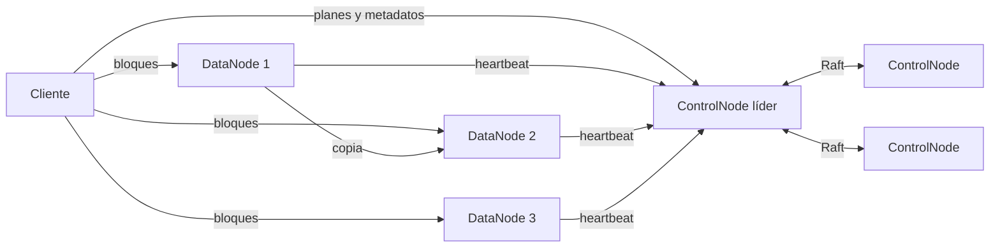

# DFSha

Sistema de archivos distribuido por bloques, con alta disponibilidad, réplicas y
cifrado. Proyecto 1 de ST0263 Tópicos Especiales en Telemática / SI3007
Sistemas Distribuidos, Universidad EAFIT, 2026-2.

Andrés Vélez Rendón y Jose Luis Restrepo.

## Cómo funciona

Un archivo se parte en bloques de 8 a 64 MiB. Cada bloque se guarda en dos
DataNodes distintos, cifrado en disco. Tres ControlNodes guardan los metadatos
(qué bloques tiene cada archivo y dónde está cada uno) y se ponen de acuerdo con
Raft, así que el sistema sigue funcionando si cae cualquiera de ellos. El
cliente le pide al ControlNode líder un plan y mueve los bloques directamente
con los DataNodes, varios a la vez: los datos nunca pasan por el ControlNode.



Todo viaja por HTTPS con una CA propia; entre ControlNodes, Raft usa TLS mutuo.
Cada usuario tiene su propio árbol de directorios y solo ve sus archivos.

El diseño completo, las APIs, los algoritmos y las pruebas están en los informes:

- [Hito 1: especificación](docs/hito-1/hito-1-especificacion.pdf)
- [Hito 2: arquitectura y comunicaciones](docs/hito-2/hito-2-arquitectura-y-comunicaciones.pdf)
- [Informe final](docs/hito-4/hito-4-informe-final.pdf)

## Estructura

| Carpeta | Contenido |
|---|---|
| `cmd/controlnode` | ControlNode en Go: metadatos, Raft, planes y mantenimiento |
| `cmd/datanode` | DataNode en Go: guarda, cifra, entrega y copia bloques |
| `cmd/admin` | Genera CA, certificados, claves y usuarios |
| `internal/common` | TLS, secretos y permisos firmados compartidos |
| `client` | Cliente de línea de comandos en Python, sin dependencias |
| `docker`, `docker-compose.yml` | Imágenes y clúster local de 3 + 3 nodos |
| `deploy/aws` | Despliegue en varias VMs de AWS Academy |
| `scripts` | Preparación, compilación, pruebas y demostración |
| `docs` | Informes de cada hito en LaTeX y PDF |

## Ejecutar en una máquina

Requiere Docker con Compose y Python 3.10 o superior. Go no hace falta.

```bash
python3 scripts/setup.py
docker compose up -d --build cn1 cn2 cn3 dn1 dn2 dn3
docker compose ps
python3 scripts/demo.py
```

`setup.py` genera en `.secrets/` la CA, los certificados, las claves y el
usuario `demo`, cuya contraseña queda en `.secrets/credentials.txt`. Esa carpeta
no se sube a Git y no se debe regenerar si ya hay datos guardados, porque con
otra clave los bloques no se podrían descifrar. `demo.py` sube y baja un archivo
de prueba y revisa cada operación.

## Usar el cliente

Con Docker, el cliente corre en un contenedor que ve la carpeta del proyecto
como `/work`:

```bash
alias dfsha='docker compose --profile tools run --rm client'
dfsha login demo
dfsha mkdir /fotos
dfsha cd /fotos
dfsha put /work/README.md readme.md
dfsha ls
dfsha stat readme.md
dfsha get readme.md /work/copia.md
dfsha status
```

| Grupo | Comandos |
|---|---|
| Sistema de archivos | `ls`, `cd`, `pwd`, `mkdir`, `rmdir`, `rm`, `mv`, `stat` |
| Transferencia | `put` (o `send`), `get` (o `receive`), con `--workers N` |
| Acceso | `open RUTA --mode r/w`, `lock`, `read RUTA OFFSET LARGO --output ARCHIVO`, `write HANDLE ARCHIVO --offset N`, `close HANDLE` |
| Clúster | `status` |

`write` no modifica bloques: arma una versión nueva del archivo y la publica
completa, y quien lo tenga abierto para leer sigue viendo la versión anterior.

## Probar fallos

```bash
docker compose stop dn1        # cae un DataNode: get usa la otra copia
docker compose start dn1
docker compose stop cn1        # si era el líder, los otros dos eligen uno nuevo
docker compose start cn1
docker compose --profile scale up -d dn4   # cuarto DataNode en caliente
docker compose logs -f cn1 cn2 cn3         # reparaciones y rebalanceos
```

`stop` y `start` conservan los datos. `docker compose down -v` borra los
volúmenes y con ellos todos los datos.

## Pruebas automáticas

Requieren Go 1.25 o superior y Python 3.10 o superior.

```bash
python3 scripts/test.py
```

Corre las pruebas unitarias de Go y Python, `go vet` y la prueba de
integración, que levanta 3 ControlNodes y 4 DataNodes como procesos reales con
TLS y prueba subidas, permisos, caídas de nodos, elección de líder, reinicio
completo, escalado y rechazo sin mayoría. Con `--extended` agrega los escenarios
lentos (vencimiento de reservas y borrado de huérfanos). El resultado queda en
`results/integration.json`.

## Despliegue en AWS

Ver [deploy/aws/README.md](deploy/aws/README.md).

## Configuración

Los parámetros se leen de variables de entorno; `.env.example` tiene los valores
por defecto.

| Variable | Defecto | Qué controla |
|---|---|---|
| `REPLICATION_FACTOR` | 2 | Copias de cada bloque, nunca más que DataNodes − 1 |
| `BLOCK_SIZE_MIN_MB`, `BLOCK_SIZE_MAX_MB` | 8, 64 | Rango del tamaño de bloque |
| `BLOCKS_PER_NODE` | 4 | Bloques mínimos por nodo que debe producir un archivo |
| `HEARTBEAT_MS`, `HEARTBEAT_MISSES` | 3000, 3 | Un DataNode se da por caído a los 9 s |
| `WRITE_LEASE_SECONDS` | 60 | Duración de la reserva de escritura |
| `MAINTENANCE_MS` | 5000 | Cada cuánto el líder repara y rebalancea |
| `GC_GRACE_SECONDS` | 120 | Espera antes de borrar bloques sin uso |
| `FULL_THRESHOLD_PERCENT` | 90 | Ocupación a la que un DataNode deja de recibir bloques |
| `REBALANCE_THRESHOLD_PERCENT` | 10 | Diferencia de ocupación que dispara el rebalanceo |
| `CAPACITY_BYTES` | 1 GiB | Espacio que cada DataNode ofrece |
