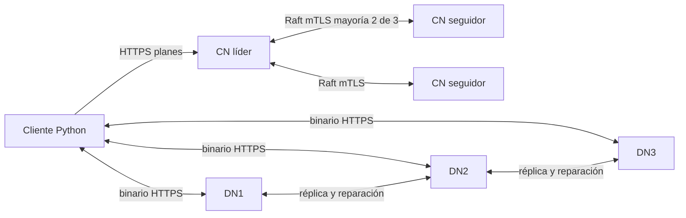

# DFSha — sistema de archivos distribuido

ST0263 / SI3007, Universidad EAFIT, 2026-2. **Andrés Vélez Rendón y Jose Luis Restrepo.**

Servidores Go, cliente Python y bloques binarios distribuidos. Tres ControlNodes conservan metadatos mediante Raft, BoltDB y snapshots; los DataNodes guardan bloques AES-256-GCM con SHA-256, réplicas y reparación. El cliente descubre ubicaciones mediante planes HTTPS. Se continuó el Hito 2 de GitHub, más avanzado que el ZIP.

**Empieza por [COMO_EJECUTAR.md](COMO_EJECUTAR.md).** También se entregan [informe PDF](output/pdf/DFSha-informe-final.pdf), [fuente del informe](docs/INFORME_FINAL.md), [API](docs/API.md), [diagramas](docs/DIAGRAMAS.md), [trazabilidad](docs/TRAZABILIDAD.md), [auditoría](docs/AUDITORIA.md), [guion del video](docs/VIDEO.md) y [despliegue AWS](deploy/aws/README.md).

## Inicio con Docker

Requiere Git, Python >=3.10 y Docker Desktop/Engine con Compose. En Windows iniciar Docker Desktop con contenedores Linux. En Linux puede corresponder `python3`. Ejecutar desde la raíz:

```sh
git clone https://github.com/AndresVelezR/DFSha---Distributed-Systems.git
cd DFSha---Distributed-Systems
python scripts/setup.py
docker compose --profile tools build
docker compose up -d cn1 cn2 cn3 dn1 dn2 dn3
docker compose ps
python scripts/demo.py
```

Esperar seis servicios `healthy`. La primera construcción descarga imágenes y módulos. Setup usa Go dentro de Docker: no necesitas instalar Go para este camino. Genera CA, certificados y claves aleatorias en `.secrets`; el usuario inicial `demo` tiene contraseña aleatoria en `.secrets/credentials.txt`. El servidor lee hashes bcrypt desde `users.json`. El archivo con contraseñas es una comodidad administrativa privada del laboratorio.

**Si existen secretos y datos, omite setup.** No cambiar la clave de cifrado ni borrar `.secrets` si se conservan bloques. El inicializador rechaza sobrescribir secretos. Nunca publicar claves, sesiones o contraseñas; están excluidos de Git.

La demo prueba un archivo de 24 MiB, tres bloques, dos réplicas, hashes, rangos, escritor único, escritura COW, archivo vacío y gestión de archivos. Lee las credenciales sin imprimirlas y deja métricas en `demo-files/`.

## CLI

La raíz del proyecto se monta como `/work`. El cliente de Compose resuelve las direcciones internas de los DataNodes; `client-session` conserva sesión, directorio actual y handles entre invocaciones.

```sh
docker compose --profile tools run --rm client login demo
docker compose --profile tools run --rm client mkdir /trabajo
docker compose --profile tools run --rm client cd /trabajo
docker compose --profile tools run --rm client put /work/README.md readme.md
docker compose --profile tools run --rm client ls
docker compose --profile tools run --rm client stat readme.md
docker compose --profile tools run --rm client get readme.md /work/demo-files/recuperado.md
docker compose --profile tools run --rm client read readme.md 0 100 --output /work/demo-files/rango.bin
docker compose --profile tools run --rm client status
```

`login demo` solicita la contraseña interactivamente. Consultar localmente `.secrets/credentials.txt` y escribir solo la contraseña. Crear la carpeta de salida antes de descargar; `demo.py` crea `demo-files`.

| Función | Sintaxis |
|---|---|
| Transferencia | `put LOCAL REMOTO [--workers 4]`, `get REMOTO LOCAL [--workers 4]`; aliases `send`, `receive` |
| Namespace | `ls [RUTA]`, `cd [RUTA]`, `mkdir`, `rmdir`, `rm`, `mv SRC DST`, `stat` |
| Apertura | `open RUTA --mode r`, `open RUTA --mode w` |
| Bloqueo y cierre | `lock RUTA` devuelve handle escritor; `close HANDLE` |
| Rango | `read RUTA OFFSET LENGTH --output LOCAL [--handle HANDLE]` |
| Escritura | `write HANDLE LOCAL --offset N [--workers 4]` |

`write` aplica los bytes de LOCAL desde OFFSET sobre una copia de la versión remota y publica una versión nueva (copy-on-write). No modifica bloques existentes. Un lector abierto conserva su versión. Los handles duran 60 s y se renuevan durante accesos activos. Cada usuario tiene árbol privado: directorios 0700 y archivos 0600, comprobados en servidor. No hay ACL de compartición.

Agregar usuario: `python scripts/setup.py --add-user --user estudiante`, y reiniciar controles para cargar `users.json`. En servicio utilizado, reiniciarlos uno por uno esperando reincorporación. Los certificados duran un año; `go run ./cmd/admin --renew-cert` reemite el certificado conservando claves de datos, con SAN personalizados en `--hosts`. Reiniciar nodos para cargarlo.

## Arquitectura y garantías



Los bytes no atraviesan el ControlNode. El bloque usa `clamp(8 MiB, tamaño/(4*N), 64 MiB)`, redondeado a potencia de dos. Los archivos pequeños pueden ocupar un bloque replicado; el vacío conserva un bloque de tamaño cero por compatibilidad con Hito 2. Se ubican por menor ocupación con carga virtual y reserva de subidas activas. Se valida capacidad por destino bajo el umbral de 90 %.

RF objetivo 2, limitado por N−1. Conforme al Hito 1 se permiten escrituras degradadas cuando faltan nodos: una sola copia no tolera su pérdida. Heartbeat DN 3 s, caída tras tres pérdidas (9 s), inventario 30 s y mantenimiento gradual. Un cuarto DN entra por registro dinámico.

Un archivo aparece después de verificar con HEAD los hashes/tamaños de todas las copias del plan y confirmar su manifiesto por mayoría. Commit es idempotente por upload ID. El cliente verifica además el hash completo al descargar. Una respuesta perdida puede dejar resultado incierto: consultar/reintentar con el mismo identificador.

Raft sustituye al matón modificado porque una elección por mayoría no define un registro seguro. HashiCorp Raft usa TCP/mTLS en 9000; las APIs históricas de elección/réplica son diagnóstico autenticado. Las lecturas requieren líder, mayoría y Barrier. Cada mutación lleva revisión CAS validada por la máquina de estados: una copia obsoleta no puede reemplazar metadatos confirmados. Sin dos controles no se aceptan operaciones autoritativas.

Reparación y rebalanceo: copiar, verificar, confirmar mapa por mayoría y conservar la ubicación retirada al menos 120 s; antes de borrar se revalidan otras copias válidas. El GC protege handles vivos, pausa durante subidas y reinicia su gracia al cambiar líder.

REST usa HTTPS con CA validada; Raft exige mTLS. Las sesiones HMAC expiran en una hora. Las capacidades de bloques se restringen por nodo, recurso y método; un token de sesión no permite acceso directo a bloques. AES-256-GCM usa nonce aleatorio por copia.

El commit también verifica la autoría registrada por cada DN después de recibir un PUT válido de esa cuenta. Conocer un hash ajeno no basta para publicar ese contenido como propio. El registro de autoría persiste junto al almacenamiento y se limpia al eliminar físicamente el bloque.

## Configuración

`.env.example` ajusta parámetros sin secretos. Compose monta `.secrets` como archivos privados.

| Variable | Valor / propósito |
|---|---|
| `CLUSTER_KEY_FILE` | clave interna, mínimo 32 caracteres |
| `SIGNING_KEY_FILE`, `ENCRYPTION_KEY_FILE` | 32 bytes expresados como 64 dígitos hex |
| `TLS_CERT`, `TLS_KEY`, `TLS_CA`, `USERS_FILE` | certificado, clave, CA y mapa de hashes bcrypt |
| `NODE_ID`, `CN_PEERS` | identidad estable; tres entradas `id@host:puertoRaft@https://host:puertoAPI` |
| `RAFT_ADDR`, `RAFT_ADVERTISE`, `METADATA_DIR` | escucha, dirección anunciada y persistencia del control |
| `DN_ADDR`, `ADVERTISE_URL`, `CONTROL_URLS`, `STORAGE_DIR` | escucha DN, URL alcanzable, controles y bloques |
| `CAPACITY_BYTES` | cuota lógica 1 GiB por DN; debe caber en disco real |
| `REPLICATION_FACTOR` | 2 |
| `BLOCK_SIZE_MIN_MB`, `BLOCK_SIZE_MAX_MB`, `BLOCKS_PER_NODE` | 8, 64, 4; MB representa MiB |
| `HEARTBEAT_MS`, `HEARTBEAT_MISSES`, `REPORT_MS` | 3000, 3, 30000 |
| `WRITE_LEASE_SECONDS`, `MAINTENANCE_MS`, `GC_GRACE_SECONDS` | 60, 5000, 120; GC mínimo 120 |
| `FULL_THRESHOLD_PERCENT`, `REBALANCE_THRESHOLD_PERCENT` | 90, 10 |
| `DFSHA_CONTROLS`, `DFSHA_CA`, `DFSHA_SESSION` | controles, CA y archivo de sesión del cliente |

Se admiten secretos por variables sin `_FILE`, pero se prefieren archivos. `DFSHA_INSECURE=true` habilita HTTP explícito para desarrollo; las evidencias de seguridad usan TLS real. Los tres votantes son fijos: no cambiar identidades/pares sobre volúmenes existentes como si fuera alta de DN.

Puertos locales en 127.0.0.1: controles 8000/8010/8020, datos 8001/8011/8021. Las URLs anunciadas son internas de Compose. Una CLI nativa no resuelve los DNS de Docker automáticamente: usar el cliente de Compose o configurar despliegue multihost alcanzable.

## Pruebas y fallos

Para pruebas nativas instalar Go >=1.25 y Python >=3.10:

```sh
python scripts/build.py
python scripts/test.py
python scripts/integration_test.py --extended
```

`--go RUTA` indica un Go fuera del PATH a build/test. Comandos separados: `go test ./...`, `go vet ./...`, `python -m unittest discover client -v`. La integración genera claves, puertos y almacenamiento temporales, ejecuta 3 CN y 3 DN, incorpora un cuarto DN y cierra sus procesos. No modifica los volúmenes Docker. La extendida espera renovación 20 s, vencimiento 60 s y gracia GC 120 s reales.

Los [resultados finales](docs/resultados/integration.json) contienen checks, hashes, métricas 1/24 MiB con workers 1/4 y logs sanitizados. La [prueba prolongada](docs/resultados/integration-extended.json) registra renovación, expiración, eliminación real de huérfanos y convergencia a dos réplicas. [Docker](docs/resultados/docker.json) y [unitarias](docs/resultados/unit.json) tienen sus propios reportes. El CI Linux ejecuta Go/Python, valida Compose, realiza integración y conserva resultados.

```sh
docker compose stop dn1
# Ejecutar get: debe usar otra copia.
docker compose start dn1
docker compose stop cn1
# Si era líder, esperar elección y ejecutar stat/get.
docker compose start cn1
docker compose --profile scale up -d dn4
docker compose --profile tools run --rm client status
docker compose logs --tail 60 cn1 cn2 cn3
```

`docker compose stop` apaga y `start` reanuda conservando datos. `down` retira contenedores conservando volúmenes. **`down -v` borra los datos persistentes de ese proyecto**; solo sirve para reiniciar deliberadamente un laboratorio. No borrar `.secrets` si se conservan volúmenes.

Para tres EC2: [deploy/aws/README.md](deploy/aws/README.md), con configuración por VM, puertos, SAN, grupos de seguridad y discos. No se ha aprovisionado AWS desde este entorno.

El informe PDF se regenera desde su Markdown con `python -m pip install reportlab` y `python scripts/export_report.py`. ReportLab solo es una dependencia de autoría del informe; no se necesita para ejecutar DFSha.

## Límites

99,5 % es un objetivo, no disponibilidad anual medida. Se confía en nodos/administradores autenticados; no hay tolerancia bizantina. No se recuperan todas las copias válidas perdidas. Se replica el estado completo por mutación; hasta 100.000 bloques por manifiesto y JSON de 16 MiB limitan la escala académica. AES-GCM autentica un bloque completo y usa memoria por bloque/petición. No hay montaje POSIX, ACL compartidas, KMS, rotación de claves de datos en línea ni membresía dinámica de controles. Proteger y respaldar metadatos y secretos.

La ejecución AWS Academy y grabación del video requieren sus respectivos entornos; se entregan procedimiento y guion sin presentarlos como ejecutados.
