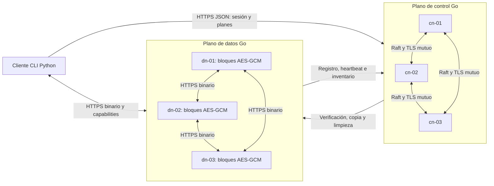
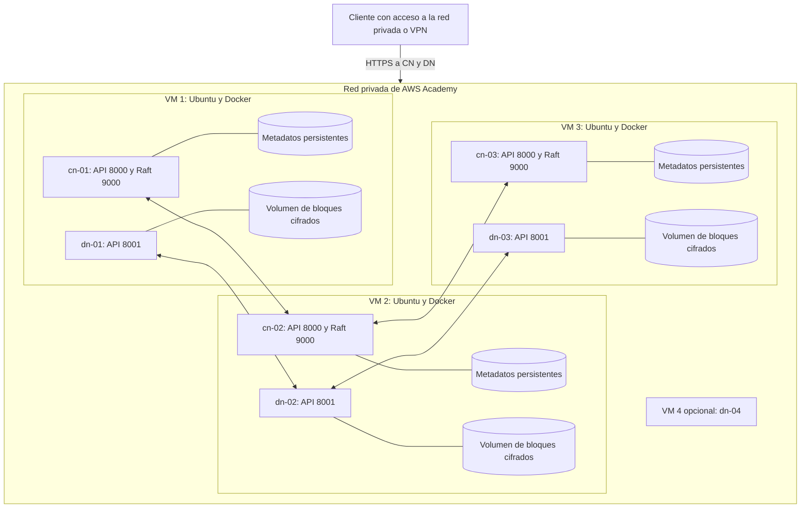
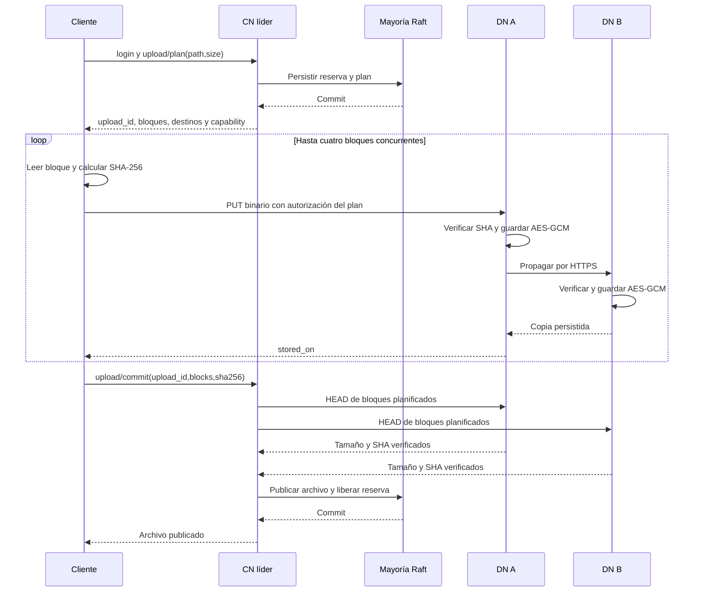
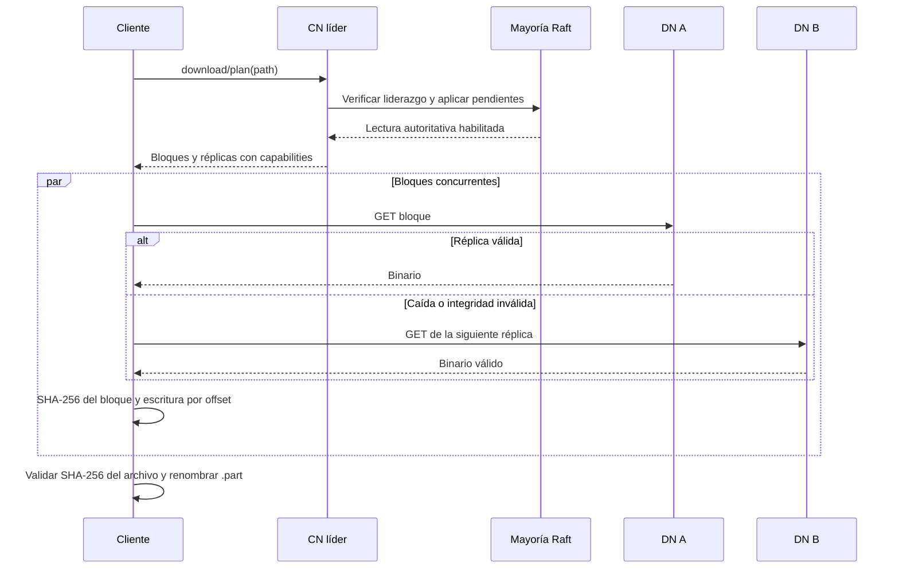
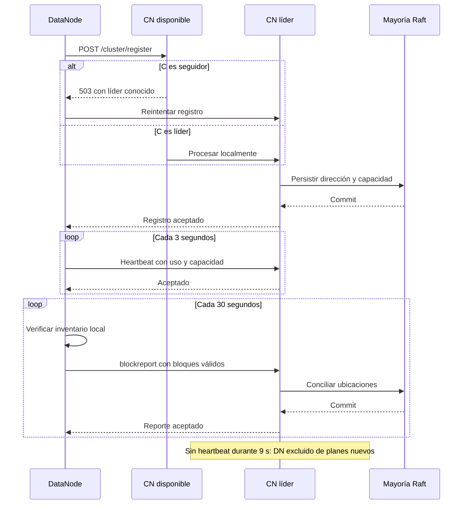
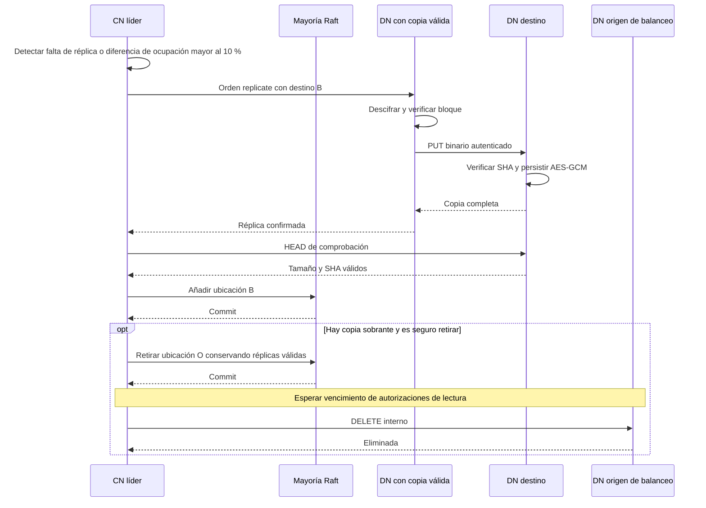
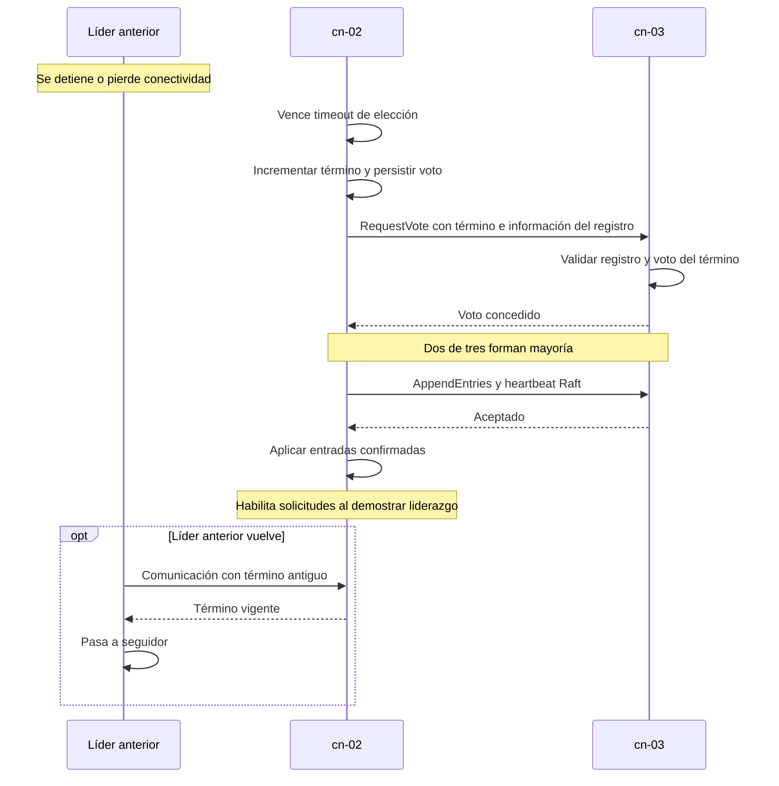
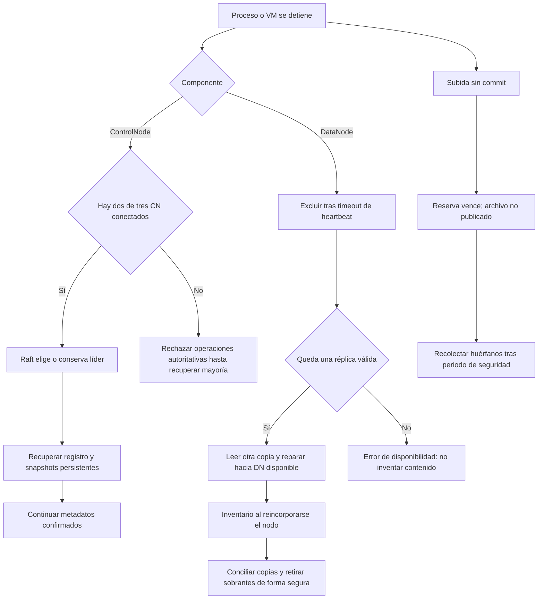

# Diagramas técnicos de DFSha

Fuente editable en Mermaid. Los diagramas describen la entrega final: REST/HTTPS para las APIs y transporte Raft con TLS mutuo para consenso entre ControlNodes. La topología de tres VMs es el despliegue previsto; ejecutar Compose en una computadora solo comprueba procesos y contenedores separados.

## 1. Arquitectura general

## 2. Distribución física

## 3. Secuencia de subida

## 4. Secuencia de descarga

## 5. Registro, heartbeat e inventario

## 6. Replicación y reparación

## 7. Elección de líder

## 8. Recuperación ante fallos

El algoritmo Raft considera fallos de parada y pérdida de comunicaciones, con almacenamiento persistente que respeta las escrituras. No se afirma tolerancia bizantina ni recuperación después de perder todas las copias válidas de datos o una mayoría de discos de control.
